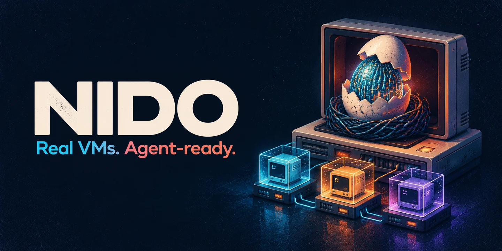
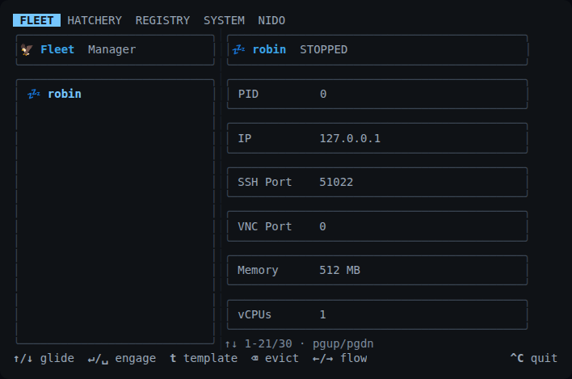
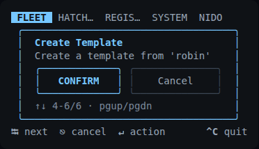
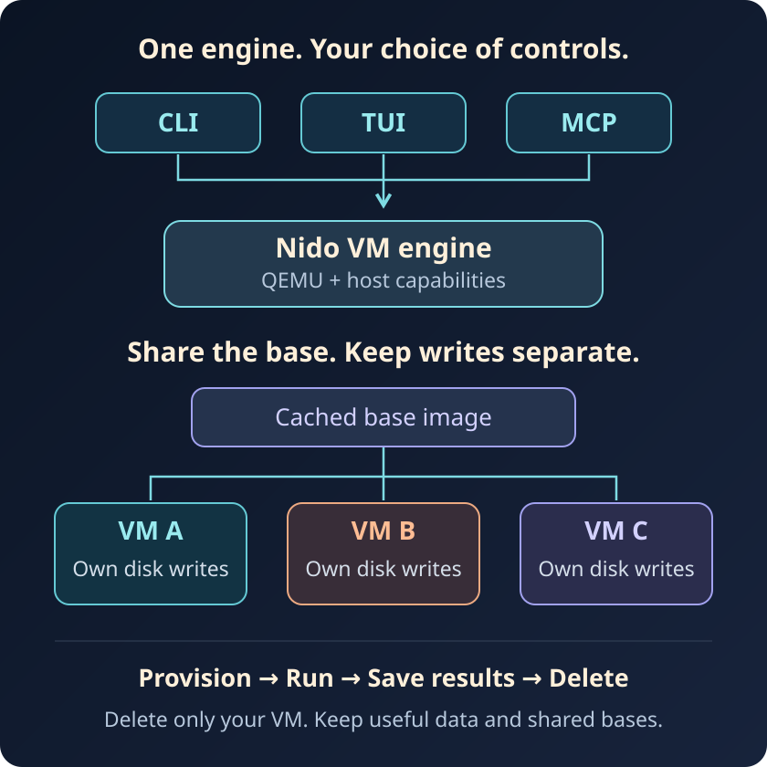

# Nido



**Real virtual machines for AI agents. One local engine, three ways to drive it: CLI, TUI and MCP.**

[](https://github.com/Josepavese/nido/releases/latest)
[](https://github.com/Josepavese/nido/actions/workflows/cross-platform.yml)
[](https://www.npmjs.com/package/nido-mcp)
[](https://registry.modelcontextprotocol.io/v0/servers?search=io.github.Josepavese/nido)
[](LICENSE)

Give an agent a machine it can provision, use and delete. Nido runs QEMU locally,
clones cached images with copy-on-write disks, and exposes the same VM lifecycle
to your terminal and your MCP client. Each VM has its own guest kernel.

**Hatch your agents. Let them fly.** Retro shell, practical machinery.

[Get started](#press-start) · [Connect an agent](#connect-your-agent) · [Documentation](docs/README.md) · [Wiki](https://github.com/Josepavese/nido/wiki)

## Why Nido?

| You want to... | Nido gives you... |
| --- | --- |
| Test code away from your host | Disposable QEMU VMs with SSH access and cloud-init provisioning |
| Let an agent manage its own environment | A built-in stdio MCP server with compact tools, read-only resources and opt-in event subscriptions |
| Reuse an expensive setup | Templates and QCOW2 linked clones, with one shared base and a writable disk per VM |
| Switch between automation and hands-on work | Structured CLI JSON, shell completion and an interactive terminal dashboard |
| Keep multiple dashboards and agents in sync | [Shared local events](docs/events.md), live TUI updates and selective MCP notifications |
| Choose the right starting point | An automatically refreshed cloud-image catalog, local templates and buildable blueprints |

AMD64 and ARM64 host/guest selection, requirements and data-preserving upgrades:
[Architecture guide](docs/architectures.md). Omitted architecture selects native; use `--arch`
on CLI, `arch` on MCP, or the TUI **Arch** selector for an explicit guest ISA.

## Press start

QEMU is required to run VMs. Nido supports Linux, macOS and Windows hosts;
hardware acceleration depends on what the host actually exposes. Start with
`nido doctor`. See [installation and host requirements](installers/README.md).

### Install

**Linux / macOS**

```bash
curl -fsSL https://github.com/Josepavese/nido/releases/latest/download/install.sh | bash
```

**Windows PowerShell**

```powershell
irm https://github.com/Josepavese/nido/releases/latest/download/install.ps1 | iex
```

Open a new terminal, then check `nido version` and `nido doctor`. The quick
installers check prerequisites and offer QEMU setup where supported.

Prefer a package manager? npm works on Linux, macOS and Windows:

```bash
npm install -g nido-mcp                # Linux / macOS / Windows launcher
brew install Josepavese/nido/nido       # macOS / Linux
go install github.com/Josepavese/nido/v5/cmd/nido@latest
```

```powershell
scoop bucket add nido https://github.com/Josepavese/scoop-nido
scoop install nido
```

**Container** (Docker/Podman, bundles QEMU; needs a KVM-capable host):

```bash
docker run -i --rm --device /dev/kvm \
  --group-add "$(stat -c %g /dev/kvm)" \
  -v nido-home:/home/nido/.nido \
  ghcr.io/josepavese/nido mcp
```

Images are rebuilt on every release at `ghcr.io/josepavese/nido` (`:{version}`,
`:{minor}`, `:latest`) and speak MCP on stdio; pass `--group-add` so the
non-root user can open `/dev/kvm`.

**Debian / Ubuntu (APT) and Fedora / RHEL (DNF)** repositories are rebuilt on
every release and served from GitHub Pages:

```bash
# Debian / Ubuntu
sudo install -d -m 0755 /etc/apt/keyrings
sudo curl -fsSL https://josepavese.github.io/nido/nido-archive-keyring.asc -o /etc/apt/keyrings/nido.asc
echo "deb [signed-by=/etc/apt/keyrings/nido.asc] https://josepavese.github.io/nido/apt/ stable main" | sudo tee /etc/apt/sources.list.d/nido.list
sudo apt-get update && sudo apt-get install nido

# Fedora / RHEL
sudo curl -fsSL https://josepavese.github.io/nido/rpm/nido.repo -o /etc/yum.repos.d/nido.repo
sudo dnf install nido
```

Install QEMU first (`qemu-system-x86 qemu-utils` / `qemu-kvm qemu-img`), then run
`nido doctor`. Both repositories are GPG-signed by the Nido package archive key
(`DBB87CB63A94ABA50B33C7B919C6A95C9D280B64`); see
[the installers guide](installers/README.md#apt-debian--ubuntu).

**Nix**: `nix run github:Josepavese/nido` builds the current source and brings
its own QEMU; see [the installers guide](installers/README.md#nix-flake-from-source).

**WinGet**: `Josepavese.Nido` is awaiting Microsoft review. See
[availability and commands](installers/README.md#winget-windows).

For MCP clients, use `npx -y nido-mcp mcp`, discover
`io.github.Josepavese/nido` in the **Official MCP Registry**, browse the **Glama**
directory for local installation instructions, or import the **MCPB bundle**.
[MCP catalogs and client installation](installers/README.md#mcp-catalogs-and-client-installation).

[All install options](installers/README.md) · [Distribution channel status](docs/DISTRIBUTION.md)

### Hatch your first VM

```bash
nido images update
nido images info ubuntu:lts
nido images pull ubuntu:lts
nido spawn agent-lab --image ubuntu:lts --memory 2048 --cpus 2
nido info agent-lab --json

# Once the guest has finished booting and SSH is ready:
nido ssh agent-lab
```

The first pull downloads the base image. Later VMs can reuse it. `ubuntu:lts`
follows the catalog's supported LTS selection; use a numbered tag from
`nido images list` when you need a specific OS release. Guest boot and cloud-init
take additional time; creating the overlay is only one part of startup.

When you have saved the work you need, shut down inside the guest and remove
**only your disposable VM**:

```bash
nido ssh agent-lab sudo poweroff
# After shutdown, confirm its state:
nido info agent-lab
nido delete agent-lab
```

`nido stop` terminates the managed QEMU process and waits for exit. Use guest
poweroff for a clean OS shutdown. VM data persists until you delete it.

[Provisioning, ports, templates and cleanup](docs/usage.md)

Watch core changes in another terminal with `nido events` or `nido events --json`.
TUI sessions update from the shared stream; agents explicitly subscribe only to
the resources they need. See [event delivery and mute controls](docs/events.md).

## A little room to roost

Run `nido gui` for a keyboard and mouse dashboard. The shared TUI kit adapts
from a split Fleet view to compact lists and scrollable dialogs, keeping your
work in place as you resize. Below its usable size, the interface rests until
you give it more room.



Even at 40x10, confirmation and cancellation stay within reach:



These are native terminal captures with private demonstration metadata. No VM
was started for the screenshots. [Themes](docs/customization.md) ·
[Reusable TUI kit](internal/tui/kit/README.md)

## Connect your agent

Nido's MCP server runs locally over **stdio**. No separate service is required.
Use an installed binary:

```json
{
  "mcpServers": {
    "nido": {
      "command": "nido",
      "args": ["mcp"]
    }
  }
}
```

Use the absolute executable path if your client does not inherit your terminal's
PATH. `nido register` prints a registration block; your client owns where it is
saved. Clients that launch npm packages can instead use `command: "npx"` with
`args: ["-y", "nido-mcp", "mcp"]`.

| Tool | Responsibility |
| --- | --- |
| `nido_vm` | Create, inspect, configure, connect and remove VMs; manage forwarded ports |
| `nido_image` | Browse and refresh the catalog; pull and manage cached images |
| `nido_template` | Save and manage reusable disk templates |
| `nido_blueprint` | Inspect and build image recipes |
| `nido_system` | Diagnostics, configuration, accelerators and installation operations |

Read-only resources include `nido://fleet/vms`, `nido://catalog/images` and
`nido://system/config`. Use `nido mcp-help` for the machine-readable tool/action
guide, or `nido mcp --help` in your terminal.

An example task for your agent:

> Create a disposable Ubuntu LTS VM named `test-lab`, provision the dependencies,
> run my tests and save their output. Delete only that VM when finished. Preserve
> other VMs and shared images.

MCP grants access to local VM and installation operations, including destructive
ones. Connect clients you trust. [MCP guide](docs/mcp.md) · [Optional VM-testing skill](docs/agent-skills.md)

## One base. Separate machines.



With linked clones enabled, the cached base stays shared while each VM records
its own disk changes. Space usage grows with those writes, logs and templates;
it is not constant as you add VMs. Nido checks backing-image dependencies before
cache removal. Keep bases in place while dependent VM disks exist.

VMs provide a separate guest kernel, but host mounts, forwarded ports and PCI
passthrough deliberately cross that boundary. Nido is not a complete security
policy for arbitrary untrusted workloads. See [operations and isolation](docs/usage.md#isolation-and-storage).

## Pick your starting point

- **Cloud image**: pull from the catalog and provision through cloud-init.
  Ubuntu, Debian, Alpine, Kali, CirrOS and openSUSE discovery follows the policies
  in `registry/sources.yaml`. [Catalog and integrity](docs/images.md)
- **Template**: save a prepared VM disk and reuse it for repeated tasks.
  [Template workflow](docs/usage.md#reuse-a-prepared-environment)
- **Blueprint**: build an image from a recipe and installer media, including
  Windows evaluation editions. [Windows guide](docs/windows.md)

The scheduled catalog job discovers new supported upstream releases. Refresh
your local copy with `nido images update`; it does not update an existing guest OS.

Prefer hands-on control? Run **`nido gui`** for the Fleet, Hatchery, Registry and
System views. Use **`--gui` on spawn/start** when you want the VM's display;
that flag and the terminal dashboard are separate features.

## Go further

| Task | Guide |
| --- | --- |
| Provision a guest, forward ports, adjust resources, share files | [Everyday workflows](docs/usage.md) |
| Write scripts against Nido | [CLI JSON contract](docs/CLI_JSON_SPEC.md) |
| Install, upgrade or choose a package channel | [Installers](installers/README.md) · [Distribution](docs/DISTRIBUTION.md) |
| Change the terminal palette | [Themes](docs/customization.md) |
| Understand runtime and hardware boundaries | [Architecture](docs/ARCHITECTURE.md) |
| Contribute or validate a change | [Contributing](CONTRIBUTING.md) · [Testing](TESTING.md) |

[Documentation index](docs/README.md) · [Changelog](CHANGELOG.md) · [Issues](https://github.com/Josepavese/nido/issues) · [MIT license](LICENSE)
